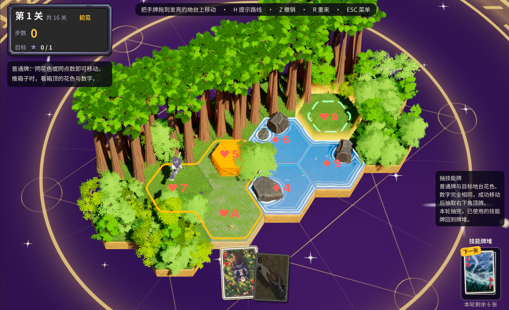
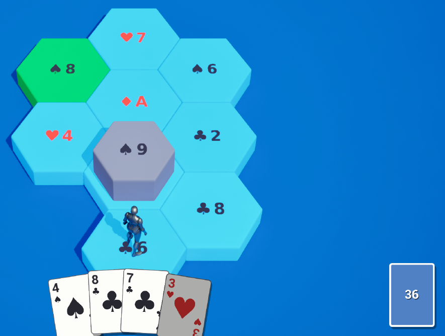
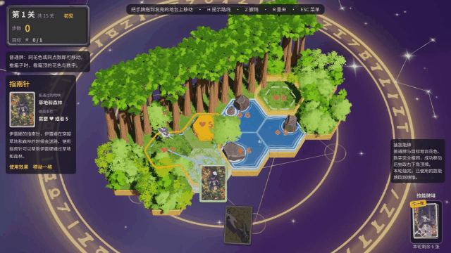
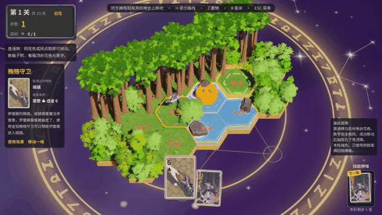
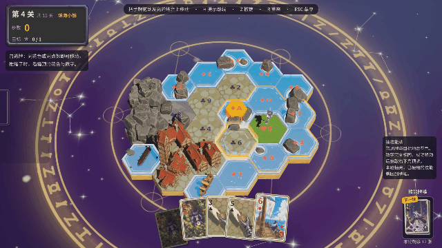

# 魔女之旅 · Hex Sokoban

> 每走一步都要打出一张牌。眼前最顺手的那张，可能正是之后最需要的那张。

《魔女之旅》是一款以魔女伊蕾娜的旅行为主题的单人解谜游戏，把六边形推箱子、扑克牌匹配和手牌规划放进了同一道题里。你一边安排旅途，一边把箱子推到目标地台上。

**[下载可游玩版本（Windows）](https://github.com/HaoZhengUniMelbStu/WitchJourney/releases/latest)**

---

## 这个游戏是怎么来的

最开始想到这个玩法，是因为最近在玩《沉星之序》。它让我重新想了一遍推箱子：十字方格上的推箱子只有四个方向，箱子的接近方式和路线组合比较少，很难设计出足够多样的有趣关卡。所以我想，能不能先从棋盘的形状开始改？

能密铺平面的正多边形只有三种：正方形、等边三角形和正六边形。等边三角形没有一组相对的平行边，箱子推进下一格之后很难设计怎么继续往前推；如果改成需要换边推，推起来就没有那种干脆的推进感，角度也成问题。因此最后我选了正六边形：六个方向都能接近和推动箱子，路线一下子丰富了很多。

但问题随之而来：六边形的输入方式是什么？WASD 显然不适合六个方向的移动。那用鼠标点击？我在最早期的 Demo 里确实是这么做的。地图小的时候还好，地图一大，弊端就出来了：六边形和相邻的六个地台紧密相接，点击很容易误触，玩起来要经常撤回，有点卡手。

更大的问题在玩法上限。推箱子本质上是一个图论问题，玩家只要找到那条路线就能通关，地图设计得再复杂，花样也就那么些，单调且缺少挑战。所以我引入了另一种玩法。

另一半灵感来自我在墨尔本大学 **AI Planning** 课程锦标赛里接触到的扑克牌连线桌游 *Sequence*。棋盘的每一格对应一张扑克牌，玩家手里有几张牌，打出哪张牌，就能在对应的格子上落子，最后连成五子获胜。我很喜欢“手里牌的点数和花色决定你能走到哪里”这种对应关系：玩家摸到手牌后要思考先落哪个、后落哪个，一下子就把简单的五子连线变成了一个既有随机性、又需要思考的桌游。于是我就想：能不能把它和推箱子结合起来？

*最早的玩法原型：六边形地台上标着花色和点数，底部是手牌，打出匹配的牌才能走上相邻的地台。*

结果就是现在的《魔女之旅》：**每个地台都有一种花色和一个点数，你只能打出花色相同或者点数相同的手牌，才能走上去。** 这是整个游戏最基本也最核心的规则，后面的技能牌都是在这套系统上锦上添花。出牌方式也从点击地台改成了把手牌拖到相邻地台上，顺带解决了误触的问题。

---

## 一张牌就是一种赶路的方法

山路难行，就找个地方生火休息；穿过草地，用指南针辨认方向；城门拦路，试着和守卫谈谈价钱；遇上水域，就搭一艘船。四种花色不只是通行标记，也对应伊蕾娜旅途中四种赶路的办法。

| 花色 | 卡牌 | 对应地形 |
|:---:|:---:|:---:|
| ♠ 黑桃 | 篝火 | 山地 |
| ♥ 红桃 | 指南针 | 草地 |
| ♣ 梅花 | 贿赂守卫 | 城镇 |
| ♦ 方块 | 帆船 | 水域 |

## 同花色走正路，同点数想办法

花色相同，就是用对的方法走对的路：红桃 5 可以带你穿过任意点数的草地。

*同花色：打出红桃牌“指南针”，伊蕾娜穿过草地。*

不过伊蕾娜是个古灵精怪的屑魔女，她总有些取巧的办法。点数相同的时候，红桃 5 也能让你走上**方块 5** 的水域：指南针并没有突然变成船，而是成了伊蕾娜换取船票的筹码。右侧的**旅行报幕**会像旅行日记一样，把这些临场发挥记下来。

*同点数：用梅花 6“贿赂守卫”走上方块 6 的水域，旅行报幕记下“伊蕾娜在镇上买到了一张船票，通过了水域”。*

这条规则有一个刻意的数值设计：花色只有 4 种，地台上的点数却是 1–10 共 10 种。随手抓一张牌，花色对上的机会远大于点数对上的机会。所以游戏鼓励你在正确的地形用正确的方法，但也给伊蕾娜留下了随机应变的空间，让每一步出牌多一层取舍。

## 手牌是有限的

每关开始时你会拿到一组固定的手牌，打一张少一张，**并且保证至少存在一种出牌顺序可以通关**。

为此我在关卡编辑器里做了两个工具：

- **解法判定**：一个基于图搜索的求解器。它把“棋盘局面 + 已用的牌 + 手里的牌”当作状态，用 A* 搜索验证当前地图和手牌能不能通关，并给出最少回合数。
- **解法卡牌生成**：根据最优路线一键生成一套对应的手牌。设计者可以在此基础上替换其中一些牌，但每次修改都必须通过解法判定，确认仍然有解，才允许创建地图。

这个设计最有趣的地方在于：开局往往很轻松，牌多、路宽，怎么走都行；但随着手牌越来越少，你可能会发现，某一步需要的恰好是很久以前随手打掉的那张牌。这也是这个游戏在推箱子路径规划上最精华的部分。

*第 4 关：前面几步走得很顺，到了最后推箱子的一步，手里只剩红桃 6，而箱子所在的地台需要方块或 A。需要的那张牌早就被打掉了。*

> 路线看起来畅通，不代表手牌足够；手里还有很多牌，也不代表每张都有用。

## 脑子不够？试试我提前准备好的桂

我自己游玩时发现，场上只有一个箱子和一个目标时其实挺简单，需要思考的深度和步数都不多；但随着箱子数量增加，需要的思考深度和长期规划能力会成倍增长。开发头几天我就觉得太难，于是加了一个显示最佳路径的功能，游戏中按 H 即可。可实际玩下来，就算开着这个“外挂”，我还是很容易在开局就打出了最后一步才需要的牌，然后 Game Over。

因此我加入了三张技能牌 J、Q、K（未来打算加入更多）。获得方式是：当你打出的普通牌与目标地台的**花色和点数完全一致**，并且成功行动后，右下角会发给你一张技能牌。发哪一张也不是随机的：我根据玩家最优路径上还需要的花色和点数做了智能喂牌，尽量发给你最可能用得上的那张。三张技能牌的效果如下：

| 技能牌 | 效果 | 计步成本 |
|:---:|---|:---:|
| **J** 疾风刃 | 原地推动箱子 | 4 步 |
| **Q** 传送阵 | 跨越障碍 | 6 步 |
| **K** 疾速飞行 | 沿直线远行 | 2 步 |

不过请注意，关卡的设计目标是**不依赖技能牌也能通关**。技能牌是用来降低难度、让更多玩家享受游戏的额外手段，给你留下改道和尝试意外解法的空间。如果你对自己的规划能力很有信心，不妨挑战一下不用任何技能牌通关。

---

## 目前可以体验的内容

- 六方向推箱子与有限手牌规划
- J、Q、K 三种技能牌
- 卡牌悬停说明与带一点剧情的旅行报幕：打出的 4 种花色 × 进入的 4 种地形，共 16 种组合，每种都有对应的旅途记录
- 普通关卡的路线提示和步数评级
- 内置关卡编辑器（解法判定 + 解法卡牌生成）
- 大地图性能模式：性能测试时我用 300 个地台拼了一张世界地图，结果持续的路径计算直接把游戏卡死了，于是专门做了这个模式，地台数量超过一定阈值后会自动启用，降低大尺寸地图下的计算压力
- 多语言：中文 / 日本語 / English / 한국어。我觉得这个游戏还挺有意思的，之后想请我的墨大同学们也来玩一玩

## 操作

| 操作 | 按键 |
|---|---|
| 出牌 | 鼠标左键把手牌拖到目标地台 |
| 查看卡牌说明 | 鼠标悬停在卡牌上 |
| 撤销 | `Z` |
| 重来 | `R` |
| 提示（普通关卡） | `H` |
| 暂停 | `Esc` |
| 平移视角 | 右键拖动 |
| 缩放 | 滚轮 |

所有箱子都到达目标地台后，关卡完成。

## 自己搭建一段旅途

内置编辑器可以放置四种地台、箱子、目标和玩家起点，配置普通手牌，然后直接试玩。森林、山体、船只和建筑可以把抽象的棋盘搭成一段旅途。放了造景的地台本质上就是空洞，玩家到不了，可以用来封路、组织路线和视线。

---

## Wiki

| 页面 | 内容 |
|---|---|
| [基础规则与操作](../../wiki/基础规则与操作) | 地台、花色、点数、推箱子规则 |
| [技能牌与抽牌](../../wiki/技能牌与抽牌) | J / Q / K 的效果、抽牌条件与计步 |
| [提示与评级](../../wiki/提示与评级) | 路线提示和步数评级怎么算 |
| [关卡编辑与造景](../../wiki/关卡编辑与造景) | 编辑器用法与可解性校验 |
| [设计笔记](../../wiki/设计笔记) | 为什么是六边形，为什么是扑克牌 |
| [常见问题](../../wiki/常见问题) | 遇到问题先看这里 |

建议先读“基础规则与操作”，再看“技能牌与抽牌”。想了解玩法从哪里来，可以读“设计笔记”。

## 项目开发

- 引擎：**Unreal Engine 5.5.4**
- 工程入口：`kurogameExamDemo.uproject`
- 核心玩法代码：`Plugins/HexSokoban`

### 编译运行

1. 安装 Unreal Engine 5.5.4 和 Visual Studio 2022（含“使用 C++ 的游戏开发”工作负载）。
2. 克隆本仓库后，右键 `kurogameExamDemo.uproject` → **Generate Visual Studio project files**。
3. 打开生成的 `kurogameExamDemo.sln`，以 `Development Editor | Win64` 编译；或直接双击 `.uproject`，在提示时选择重新编译模块。

仓库只包含资源与代码源文件，`Binaries/`、`Intermediate/`、`Saved/`、`DerivedDataCache/` 等生成目录已通过 `.gitignore` 排除。

## 反馈问题

提 Issue 时请附上：关卡名称、所用语言、操作顺序，以及能看清手牌和棋盘的截图。

---

本项目为个人非商业同人作品，角色与世界观取材自《魔女之旅》（白石定規），相关版权归原作者及权利方所有。
