# The Witch's Journey · Hex Sokoban

> Every step costs a card. The easiest card to play now may be the one you need most later.

The Witch's Journey is a single-player puzzle game inspired by the travels of the witch Elaina. It combines hexagonal Sokoban, playing-card matching, and hand management: plan your journey while pushing every box onto a goal tile.

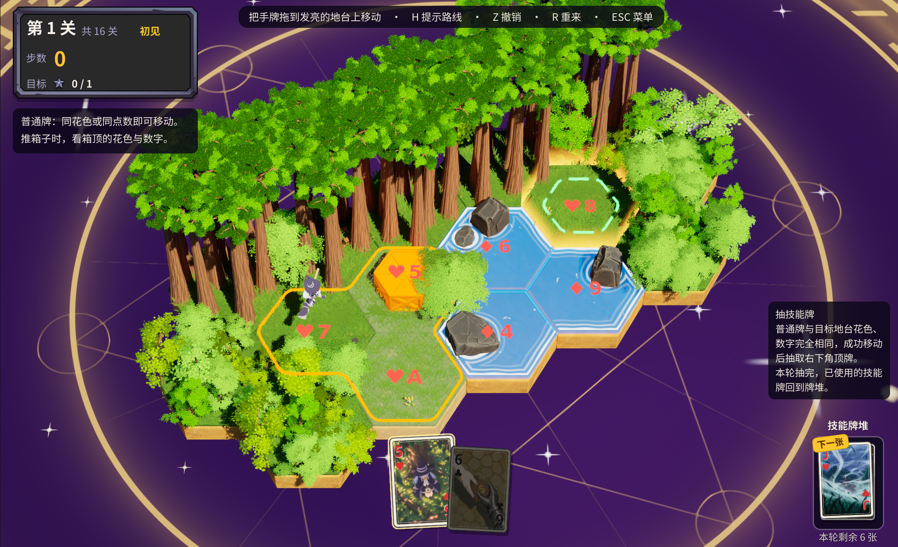

<b><a href="https://github.com/HaoZhengUniMelbStu/WitchJourney/releases/latest">⬇ Download the playable Windows build</a></b>

---

## How the game began

The initial idea came from playing *Order of the Sinking Star*. It made me reconsider Sokoban: on a square grid, boxes can only be approached from four directions, which limits the combinations of approaches and routes available for interesting levels. I wondered whether changing the board's shape would help.

Only three regular polygons can tile a plane on their own: squares, equilateral triangles, and regular hexagons. Equilateral triangles have no parallel opposite edges, making it awkward to keep pushing a box forward after it enters the next tile. Requiring the player to change sides would lose the clean feeling of a straight push and introduce awkward angles. I chose regular hexagons instead: six directions for approaching and pushing boxes immediately opened up more routes.

That brought a new question: how should movement work? WASD does not naturally fit six directions. Mouse clicks? That was how the earliest demo worked. It was fine on small maps, but on larger ones, each hexagon and its six neighbors were so tightly packed that misclicks became common. Constantly undoing moves made the controls feel clumsy.

There was also a limit to the gameplay itself. Sokoban is fundamentally a graph problem: once you find the right route, you can finish the level. More elaborate maps alone did not give me the variety and challenge I wanted, so I introduced another mechanic.

The other half of the idea came from *Sequence*, a card-based board game I encountered in a tournament for the University of Melbourne's **AI Planning** course. Each board space corresponds to a playing card. Players play cards from their hands to place pieces on matching spaces, aiming to make a row of five. I liked how the suits and ranks in your hand determine where you can go. Deciding which card to use first turns a simple five-in-a-row objective into a game of both chance and planning. Could that work with Sokoban?

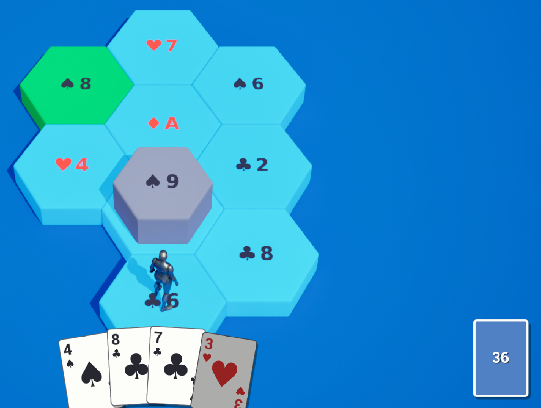

<i>The earliest prototype: hexagonal tiles display suits and ranks, with cards along the bottom. Play a matching card to step onto an adjacent tile.</i>

The result is The Witch's Journey: **every tile has a suit and a rank, and you can only enter it by playing a card that matches either its suit or its rank.** This is the central rule; skill cards build on top of it. Playing a card also changed from clicking a tile to dragging a card onto an adjacent tile, helping resolve the misclick problem.

---

## Every card is a way to travel

When the mountain road is harsh, find somewhere to light a fire and rest. Use a compass to cross grasslands. If the city guards block your way, negotiate a price. When you reach water, board a boat. The four suits are more than access symbols: each represents one of Elaina's ways of getting around.

<table>
  <tr>
    <th width="25%">♠ Spades · Campfire</th>
    <th width="25%">♥ Hearts · Compass</th>
    <th width="25%">♣ Clubs · Bribe the Guards</th>
    <th width="25%">♦ Diamonds · Sailboat</th>
  </tr>
  <tr>
    <td align="center" valign="top">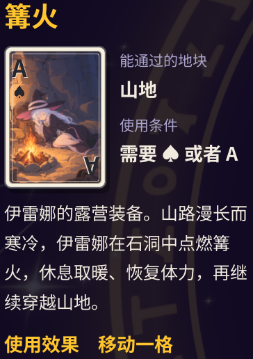</td>
    <td align="center" valign="top">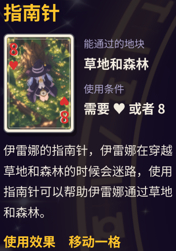</td>
    <td align="center" valign="top">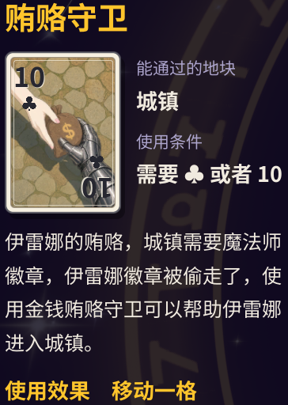</td>
    <td align="center" valign="top">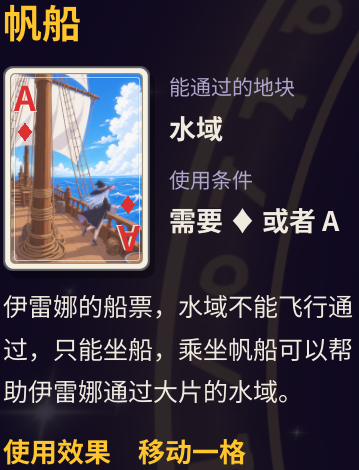</td>
  </tr>
  <tr>
    <td align="center"><b>Mountains</b></td>
    <td align="center"><b>Grasslands and forests</b></td>
    <td align="center"><b>Towns</b></td>
    <td align="center"><b>Water</b></td>
  </tr>
  <tr>
    <td valign="top">Mountain roads are long and cold. Light a campfire in a cave, rest and warm up, then continue across the mountains.</td>
    <td valign="top">It is easy to lose your way in grasslands and forests. A compass keeps you on course.</td>
    <td valign="top">With her witch's brooch stolen, Elaina has to pay off the guards to enter town.</td>
    <td valign="top">Large stretches of water cannot be crossed by flying. Buy a ticket and take a boat.</td>
  </tr>
</table>

Each ordinary card moves Elaina one tile. Matching the suit means using the right method for the terrain; matching the rank means finding another way.

## Match the suit, or improvise with the rank

A matching suit gives you the straightforward route: the five of hearts lets you cross any grassland tile, regardless of rank.

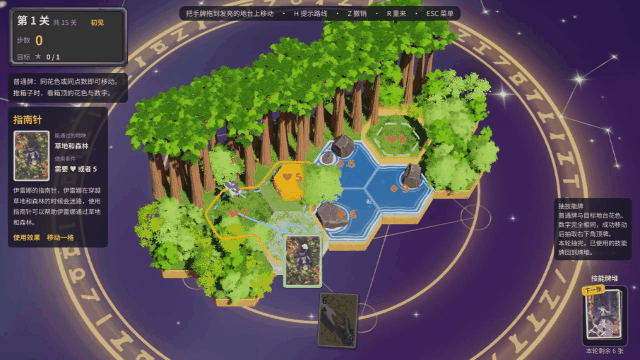

<i>Matching suit: play a heart card, Compass, to guide Elaina across grassland.</i>

But Elaina is a mischievous, resourceful witch, always ready to find a shortcut. With a matching rank, the five of hearts can also take you onto a **five of diamonds** water tile. The compass has not turned into a boat: it has become something she can trade for a ticket. The **travel narration** on the right records these improvised solutions like a travel diary.

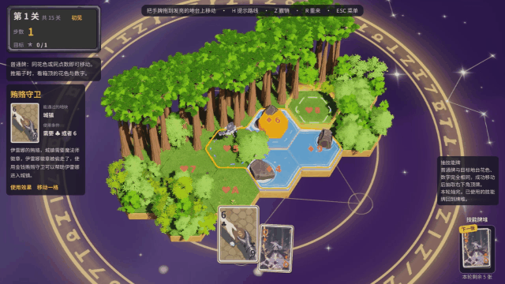

<i>Matching rank: play the six of clubs, Bribe the Guards, to enter a six of diamonds water tile. The narration records: "Elaina bought a boat ticket in town and crossed the water."</i>

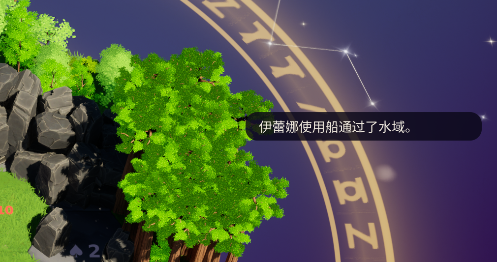

<i>Travel narration: each card played adds a short travel entry on the right. Four card suits × four terrain types produce 16 combinations, each with its own text.</i>

There is a deliberate numerical choice behind this rule: there are only four suits, but ten tile ranks, from 1 to 10. A randomly chosen card is much more likely to match a suit than a rank. This encourages the right method for the right terrain while leaving room for Elaina to improvise, adding another trade-off to every card played.

## Your cards are limited

Each level starts with a fixed set of cards. Every card you play is used up, and **at least one sequence of card plays is guaranteed to solve the level**.

I built two tools into the level editor to support this:

- **Solution Check**: a graph-based solver that treats the board position, used cards, and remaining hand as a state. It uses A* search to check whether the current map and hand can be solved and reports the minimum turn count.
- **Generate Solution Cards**: generates a matching hand from the optimal route in one click. Designers can then replace some cards, but every change must pass Solution Check before the map can be created.

The most interesting part is how the pressure builds. Early on, you have plenty of cards and open paths. Later, with fewer cards left, you may discover that a move requires the exact card you casually spent much earlier. That is the heart of this game's approach to Sokoban route planning.

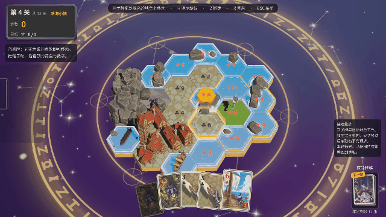

<i>Level 4: the opening moves go smoothly, but at the final box push, only the six of hearts remains. The box's tile requires a diamond or an ace. The card you need has already been spent.</i>

> An open route does not mean you have the cards to follow it. A full hand does not mean every card is useful.

## Stuck? Try the help I prepared

In my own playtests, one box and one goal were fairly manageable: neither the planning depth nor the number of moves was large. As more boxes were added, the need for deeper thinking and long-term planning grew dramatically. A few days into development, I already found it too hard, so I added an optimal-route hint, activated with H. Even with that "cheat," I still often spent a card at the beginning that I would need for the final step, then hit Game Over.

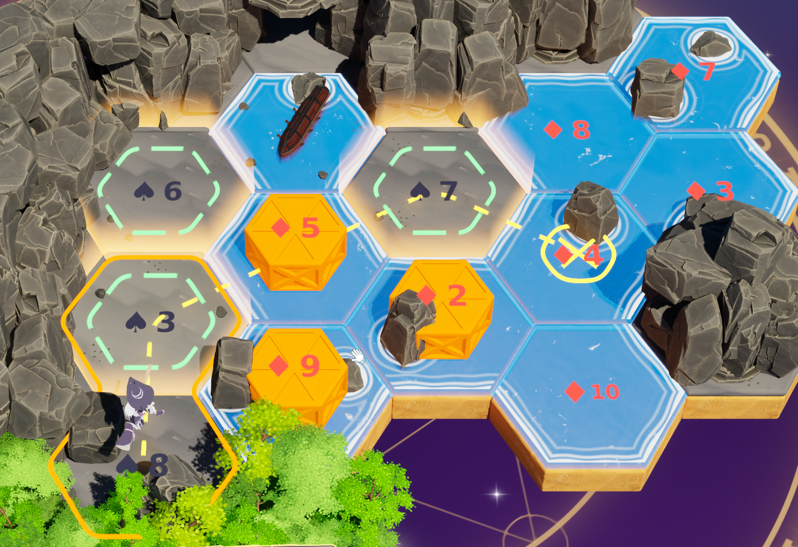

<i>Press H to show the optimal route. The yellow dashed line is the solver's recommendation, the yellow ring marks its endpoint, and green dashed outlines mark goal tiles.</i>

I therefore added three skill cards: J, Q, and K, with more planned. After a successful move using an ordinary card that **matches both the suit and rank** of the destination tile, you receive a skill card in the lower-right corner. The choice is not purely random: the system considers the suits and ranks still needed along your optimal route and tries to give you a useful card. Skill cards also have suits and only affect matching-suit tiles.

<table>
  <tr>
    <th width="33%">J · Wind Blade</th>
    <th width="33%">Q · Teleportation</th>
    <th width="33%">K · Swift Flight</th>
  </tr>
  <tr>
    <td align="center" valign="top">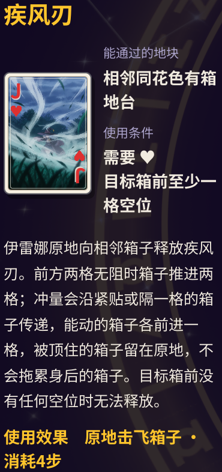</td>
    <td align="center" valign="top">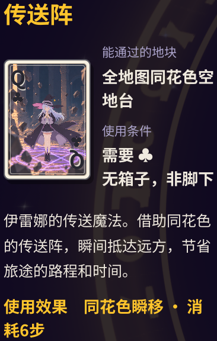</td>
    <td align="center" valign="top">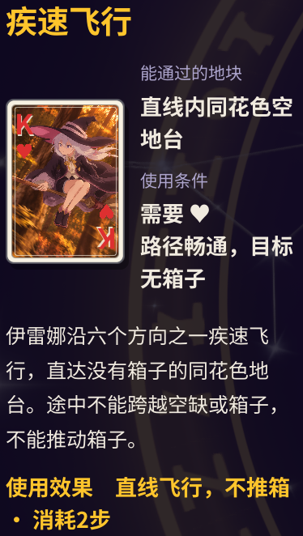</td>
  </tr>
  <tr>
    <td valign="top"><b>Launch a box without moving</b> Push an adjacent box on a matching-suit tile up to two tiles away. The impulse can also transfer to boxes ahead.</td>
    <td valign="top"><b>Teleport to a matching suit</b> Instantly reach any empty matching-suit tile on the map, ignoring distance and obstacles.</td>
    <td valign="top"><b>Fly in a straight line</b> Fly in one of six directions to an empty matching-suit tile. You cannot cross gaps or boxes.</td>
  </tr>
  <tr>
    <td align="center">Costs <b>4</b> steps</td>
    <td align="center">Costs <b>6</b> steps</td>
    <td align="center">Costs <b>2</b> steps</td>
  </tr>
</table>

See [Skill Cards and Draws](https://github.com/HaoZhengUniMelbStu/WitchJourney/wiki/Skill-Cards-and-Draws) in the Wiki for detailed rules.

Levels are designed to be **solvable without skill cards**. These cards are optional help, making the game more approachable and giving you room to change course or try unexpected solutions. If you trust your planning, try finishing without them.

---

## What you can play now

- Six-direction box pushing and limited-hand planning
- Three skill cards: J, Q, and K
- Card hover descriptions and short travel narration: four card suits × four terrain types, for 16 combinations with their own travel entries
- Route hints and step-based ratings in normal levels
- A built-in level editor with Solution Check and Generate Solution Cards
- Large-map performance mode: during testing, a 300-tile world map froze the game with continuous path calculations. This mode activates automatically above a tile-count threshold to reduce the workload on large maps
- Four languages: Chinese, Japanese, English, and Korean. I enjoy the game and hope to invite my University of Melbourne classmates to try it too

## Controls

| Action | Input |
|---|---|
| Play a card | Left-drag a card from your hand onto the destination tile |
| View a card description | Hover over the card |
| Undo | `Z` |
| Restart | `R` |
| Hint (normal levels) | `H` |
| Pause | `Esc` |
| Pan the camera | Right-drag |
| Zoom | Mouse wheel |

The level is complete when every box is on a goal tile.

## Build your own journey

The built-in editor lets you place all four terrain types, boxes, goals, and the player start, configure the ordinary cards, and playtest immediately. Forests, mountains, boats, and buildings turn the abstract board into a journey. Tiles occupied by scenery effectively act as gaps: the player cannot enter them. Use them to block paths, organize routes, and guide the player's eye.

---

## Wiki

| Page | Contents |
|---|---|
| [Rules and Controls](https://github.com/HaoZhengUniMelbStu/WitchJourney/wiki/Rules-and-Controls) | Tiles, suits, ranks, and box-pushing rules |
| [Skill Cards and Draws](https://github.com/HaoZhengUniMelbStu/WitchJourney/wiki/Skill-Cards-and-Draws) | J / Q / K effects, draw conditions, and step costs |
| [Hints and Ratings](https://github.com/HaoZhengUniMelbStu/WitchJourney/wiki/Hints-and-Ratings) | Route hints and step-based ratings |
| [Level Editor and Scenery](https://github.com/HaoZhengUniMelbStu/WitchJourney/wiki/Level-Editor-and-Scenery) | Editor tools and solvability checks |
| [Design Notes](https://github.com/HaoZhengUniMelbStu/WitchJourney/wiki/Design-Notes) | Why hexagons, and why playing cards? |
| [FAQ](https://github.com/HaoZhengUniMelbStu/WitchJourney/wiki/FAQ) | Start here if something is unclear |

Start with Rules and Controls, then Skill Cards and Draws. For the thinking behind the game, read Design Notes.

## Development

- Engine: **Unreal Engine 5.5.4**
- Project entry point: `WitchJourney.uproject`
- Core gameplay code: `Plugins/HexSokoban`

### Build and run

1. Install Unreal Engine 5.5.4 and Visual Studio 2022 with the **Game development with C++** workload.
2. Clone this repository, right-click `WitchJourney.uproject`, and select **Generate Visual Studio project files**.
3. Open `WitchJourney.sln` and build with `Development Editor | Win64`, or open the `.uproject` directly and rebuild the modules when prompted.

The repository contains source code and assets. Generated directories such as `Binaries/`, `Intermediate/`, `Saved/`, and `DerivedDataCache/` are excluded through `.gitignore`.

## Report a problem

When opening an issue, include the level name, selected language, steps to reproduce, and a screenshot that clearly shows the hand and board.

---

This is a personal, non-commercial fan work. Its characters and setting are based on Wandering Witch: The Journey of Elaina by Jougi Shiraishi. All related rights belong to the original creator and respective rights holders.
